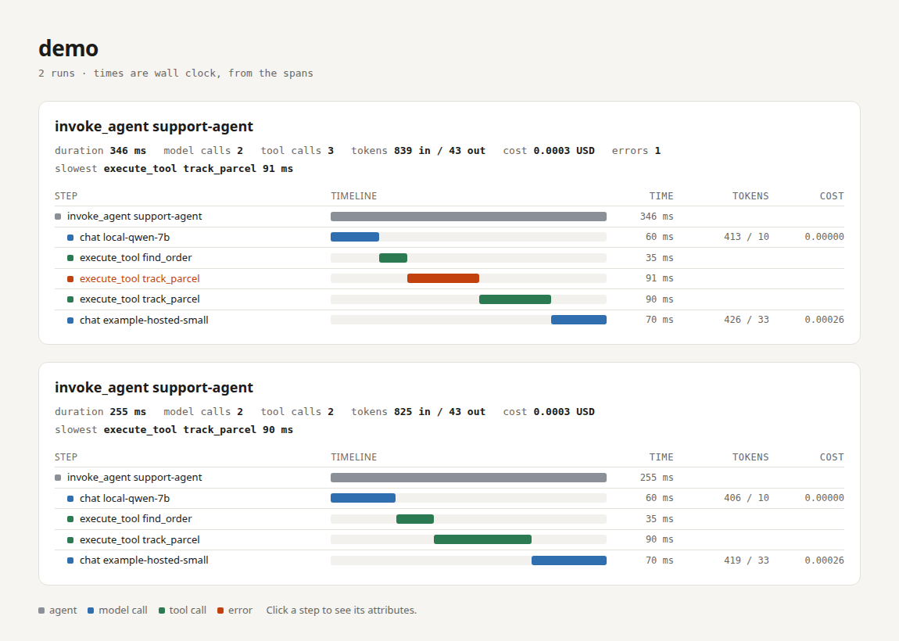
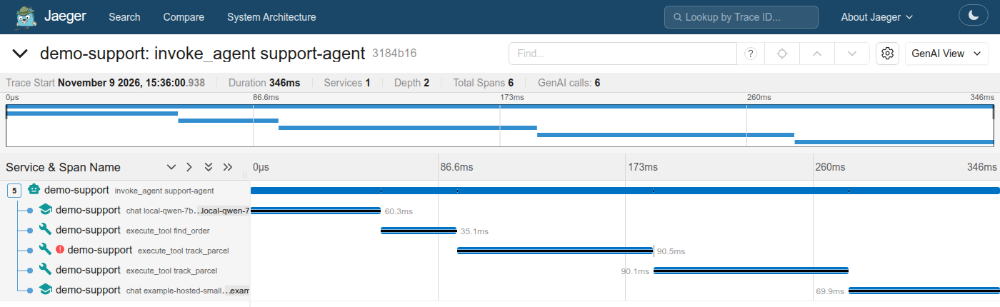
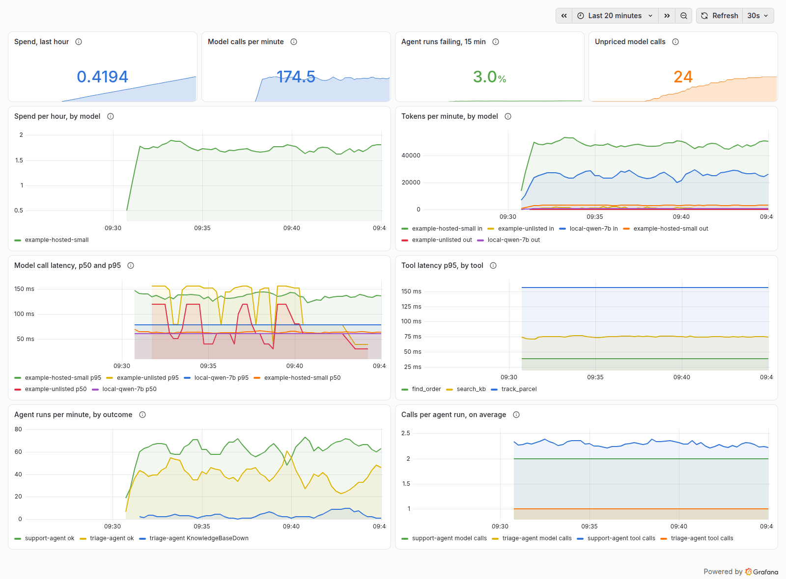

# agent-otel

An agent run is a chain of model calls and tool calls, and when it is slow or expensive you want to know which
step. agent-otel records each step as an OpenTelemetry span with the GenAI semantic conventions, adds token and
cost totals per run, and shows a run as a waterfall you can open in a browser. Give it a meter provider and it
also records the GenAI metrics (tokens, cost, latency per model, tool and agent) for dashboards and alerts.



## Try it in under a minute

```sh
git clone https://github.com/Ahmedabied/agent-otel && cd agent-otel
python3 -m venv .venv && . .venv/bin/activate && pip install -e .
python examples/demo_agent.py          # a pretend support agent; no real model is called
agent-otel summary runs/demo.jsonl
agent-otel view runs/demo.jsonl --open
```

```
invoke_agent support-agent  (464a8c2f)
  346 ms, 2 model calls, 3 tool calls, 839 in / 43 out tokens, cost 0.0003 USD, 1 errors
  slowest step: execute_tool track_parcel 91 ms
```

## Use it

```python
import agent_otel as ao

ao.setup("runs/today.jsonl", service="support-bot", prices="prices.json")

with ao.agent("support-bot", conversation_id=conv_id):
    with ao.model_call("qwen2.5:7b", provider="ollama", max_tokens=512) as m:
        reply = client.chat(...)
        m.record(input_tokens=reply.usage.prompt_tokens, output_tokens=reply.usage.completion_tokens,
                 finish_reasons=[reply.finish_reason])

@ao.tool()                      # every call of this function is a tool span, sync or async
def find_order(email: str) -> dict:
    ...
```

**Token counts mean what the OpenTelemetry GenAI conventions say.** `input_tokens` is all input tokens, cached
ones included; `cache_read_input_tokens` and `cache_write_input_tokens` say how many of them were read from or
written to the provider's prompt cache. Some APIs report input without the cached parts (Anthropic's
`usage.input_tokens` is one), so pass the sum there:

```python
u = reply.usage
read, write = u.cache_read_input_tokens or 0, u.cache_creation_input_tokens or 0
m.record(input_tokens=u.input_tokens + read + write, output_tokens=u.output_tokens,
         cache_read_input_tokens=read, cache_write_input_tokens=write)
```

If the cache counts are bigger than `input_tokens`, they cannot be part of it: agent-otel adds them and warns, so
the cost is not silently too low.

Tracing never raises into your code. A tool result that cannot be turned into JSON (a circular list, an object
whose `__str__` fails) is recorded as a size-capped repr.

`setup` is the quick local path: spans go to a JSON lines file for `agent-otel summary` and `view`. If your
application already sets up OpenTelemetry, skip `setup`: agent-otel uses the global tracer provider, so its spans
join your existing traces and go wherever your exporters send them. `ao.configure(provider)` picks a provider
explicitly.

## Send it to Jaeger, or any OTLP backend

agent-otel only makes standard OpenTelemetry spans, so the stock OTLP exporter sends them anywhere. The demo agent,
exported to Jaeger 2.23 and opened in its trace view:



Jaeger's GenAI view recognises the spans as they are: it counts the model and tool calls ("GenAI calls: 6") and
marks the agent, model and tool spans. The failed carrier call and its retry show as two tool spans.

```sh
./jaeger                         # the binary from a Jaeger 2.x release; OTLP on :4318, the UI on :16686
pip install -e '.[otlp]'
python examples/otlp_jaeger.py   # sends two runs, reads them back from Jaeger's API, checks every span
```

CI runs the same check against a real Jaeger on every push: both runs stored, all five kinds of span present,
token counts kept as integers, the run cost on the agent span.

## Metrics for dashboards and alerts

A trace answers "what happened in this run". Metrics answer the questions across all runs: spend per model per
hour, p95 latency per tool, how often an agent fails. Pass a `MeterProvider` and agent-otel records the GenAI
metrics from the same numbers as the spans:

```python
from opentelemetry.exporter.otlp.proto.http.metric_exporter import OTLPMetricExporter
from opentelemetry.sdk.metrics import MeterProvider
from opentelemetry.sdk.metrics.export import PeriodicExportingMetricReader

meters = MeterProvider(metric_readers=[PeriodicExportingMetricReader(OTLPMetricExporter())])
ao.configure(prices="prices.json", meter_provider=meters)  # or opentelemetry.metrics.get_meter_provider()
```

| metric | kind | recorded | attributes |
|---|---|---|---|
| `gen_ai.client.inference.duration` | histogram, s | each model call | `gen_ai.operation.name`, `gen_ai.provider.name`, `gen_ai.request.model`, `gen_ai.response.model`, `error.type` when it failed |
| `gen_ai.client.inference.operation.input_tokens`, `.output_tokens` | histogram | each model call, 0 when no usage came back | the same |
| `gen_ai.client.inference.usage.input_tokens`, `.output_tokens`, `.cache_read.input_tokens`, `.cache_write.input_tokens`, `.reasoning.output_tokens` | counter | positive amounts only | the same without `error.type`, plus `gen_ai.token.modality="unknown"` (not on reasoning) |
| `gen_ai.client.embeddings.duration`, `.operation.input_tokens` | histogram | calls with `operation="embeddings"`, instead of the inference ones | as the inference ones |
| `gen_ai.execute_tool.duration` | histogram, s | each tool call | `gen_ai.tool.name`, `gen_ai.tool.type`, `gen_ai.agent.name`, `error.type` |
| `gen_ai.invoke_agent.duration` | histogram, s | each agent run | `gen_ai.agent.name`, `error.type` |
| `gen_ai.invoke_agent.inference_calls`, `.tool_calls` | histogram | each agent run: the calls it made itself, so a nested agent counts its own and no call is counted twice | `gen_ai.agent.name` |
| `agent_otel.cost`, `agent_otel.unpriced_calls` | counter | model calls with usage, when you gave a price table | as the model call, plus the currency on cost |

- Each value is recorded once, when the call's block ends, from its final numbers and the same clock reading as
  its span: a metric's duration equals the span's to the nanosecond (tested), so a dashboard and a trace agree.
- Only low-cardinality attributes. No conversation, response, tool call or agent ids and no content, even with
  `capture_content=True` (tested): each distinct value would be its own time series.
- The bucket boundaries are the conventions' own (10 ms to 82 s for calls, up to a day for agent runs).
- The names are from semantic-conventions-genai at commit e6658f1 (2026-11-06), where these metrics are still
  unreleased. They replace `gen_ai.client.token.usage` and, for these operations, `gen_ai.client.operation.duration`,
  so a dashboard built on those older names will not show these.

Checked against a real Prometheus (3.16, its OTLP receiver):

```sh
./prometheus --web.enable-otlp-receiver   # Prometheus 3.x; OTLP in at :9090/api/v1/otlp/v1/metrics
pip install -e '.[otlp]'
python examples/otlp_prometheus.py        # sends three runs, reads them back with PromQL, compares with the spans
```

```
check                         from the spans   in Prometheus
model calls                                5               5
input tokens                            1676            1676
output tokens                             89              89
tool calls                                 5               5
failed tool calls                          1               1
agent runs                                 3               3
cost                               0.0005215       0.0005215
unpriced model calls                       1               1
model calls, per run sums                  5               5
names in alerts.yml stored                 5               5
ModelCallsUnpriced fires                   1               1
SpendAboveBudget's hour            0.0005215       0.0005215
```

CI runs it on every push, and the TypeScript side's own check (`node js/examples/otlp-prometheus.ts`) after it.
Prometheus stores the names as `gen_ai_client_inference_usage_input_tokens_total`,
`gen_ai_execute_tool_duration_seconds_bucket` and so on, so the two questions above become:

```promql
sum by (gen_ai_request_model) (increase(agent_otel_cost_total[1h]))
histogram_quantile(0.95, sum by (le, gen_ai_tool_name) (rate(gen_ai_execute_tool_duration_seconds_bucket[5m])))
```

### A Grafana dashboard

[examples/grafana/agent-otel.json](examples/grafana/agent-otel.json) is a dashboard for these metrics: spend in
the last hour, model calls per minute, the share of agent runs failing, unpriced calls; then spend per hour and
tokens per minute by model, model latency (p50, p95) and tool latency (p95), agent runs by outcome, and how many
model and tool calls each run makes (a climbing line is an agent looping).



```sh
./prometheus --web.enable-otlp-receiver
python examples/feed_prometheus.py --seconds 900     # one process, metrics every 5 s, varied pretend traffic
# Grafana with the files in examples/grafana/provisioning (a data source with uid "prometheus", the dashboard):
PROMETHEUS_URL=http://localhost:9090 AGENT_OTEL_DASHBOARDS=$PWD/examples/grafana \
  GF_PATHS_PROVISIONING=$PWD/examples/grafana/provisioning ./bin/grafana server
python examples/grafana/check_dashboard.py --grafana http://localhost:3000   # every panel returns numbers
```

CI provisions the dashboard into a real Grafana 13.3, feeds it for 90 seconds and checks it the same way: the
dashboard Grafana loaded has the file's panels, and every panel query, sent through Grafana's own query API,
returns finite numbers (a p95 over empty buckets is NaN, a blank panel). Set the data source's `timeInterval` to
your export interval (the OpenTelemetry SDK sends every 60 s by default), so `$__rate_interval` windows hold
enough samples.

### Alerts

[examples/prometheus/alerts.yml](examples/prometheus/alerts.yml) has five starting rules: an agent whose runs fail
(over 10% in 15 minutes, pages), a model whose calls fail (over 5%, pages), a slow tool (p95 over 10 s, ticket),
spend over an hourly budget (pages), and calls to a model missing from the price table (ticket: every cost total
leaves them out until you add it). Each threshold is a placeholder for your own traffic.

They have unit tests ([alerts.test.yml](examples/prometheus/alerts.test.yml), `promtool test rules`): each rule
fires on the series it is written for, stays quiet below its threshold and inside its `for` window, and names the
right agent, model or tool. Tests on made-up series can pass where real data does not, so the Prometheus check
above also confirms that every name the rules use was really stored, and runs the spend and unpriced rules on the
real run: the unpriced rule names the model the spans left unpriced, and the spend rule's hour equals the spans'
cost. Both run in CI.

That check caught a mistake in the first version of these rules. A counter sent over OTLP starts when it is first
counted, so Prometheus's first sample of it is already above zero, and `increase()` cannot see what came before
it: the unpriced rule never fired for a model's first unpriced calls, and the spend rule left out the whole spend
of a short job. Both are now written around that (see the comments in the file), with tests where the series is
absent and then appears above zero. The two failure-rate rules still miss a newly failing agent's or model's first
export interval (60 s by default).

## What each span carries

| span | name | attributes |
|---|---|---|
| agent run | `invoke_agent <name>` | `gen_ai.operation.name`, `gen_ai.agent.name`, `gen_ai.conversation.id`, and totals for everything inside it: `agent_otel.total.input_tokens`, `.output_tokens`, `.model_calls`, `.tool_calls`, `.cost`, and `.unpriced_calls` (model calls the cost leaves out because their model is not in your price table) |
| model call | `chat <model>` (kind CLIENT) | `gen_ai.provider.name`, `gen_ai.request.model`, `gen_ai.request.max_tokens`, `gen_ai.request.temperature`, `gen_ai.response.model`, `gen_ai.response.finish_reasons`, `gen_ai.usage.input_tokens`, `gen_ai.usage.output_tokens`, `gen_ai.usage.cache_read.input_tokens`, `gen_ai.usage.cache_write.input_tokens`, `agent_otel.cost` |
| tool call | `execute_tool <name>` | `gen_ai.tool.name`, `gen_ai.tool.call.id`, `gen_ai.tool.type`; arguments and result only with `capture_content=True` |

An exception marks the span as an error with `error.type` and an exception event, and still propagates.

The GenAI names were read from `opentelemetry-semantic-conventions` 0.66b2, where they are marked as moved to the
separate [semantic-conventions-genai](https://github.com/open-telemetry/semantic-conventions-genai) repository.
They are defined in [conventions.py](src/agent_otel/conventions.py) rather than imported, so the next move does not
break anything. The deprecated `gen_ai.system` and `gen_ai.usage.prompt_tokens` are not used. Cache writes use
`gen_ai.usage.cache_write.input_tokens`, the name in the GenAI repository's registry as of 2026-11-05 (0.66b2 still
had `cache_creation`).

## Prices are yours

agent-otel ships no price list. Prices change, and a number from someone else's table is a guess with a dollar sign
on it. You give a table, per million tokens, with model name globs, and cost is computed only for models in it:

```json
{"currency": "USD",
 "models": {"local-*": {"input": 0, "output": 0},
            "example-hosted-small": {"input": 0.5, "output": 1.5, "cache_read": 0.05, "cache_write": 0.625}}}
```

`cache_read` and `cache_write` are optional; without them, cached tokens cost the same as other input. The values
in [examples/prices.example.json](examples/prices.example.json) are placeholders. A model that is not in your table
gets token counts but no cost, never a made-up one, and the run's total says how many calls it left out:
`agent-otel summary` prints `cost 0.0045 USD (1 of 2 model calls unpriced, not in it)`.

## How much it costs to trace

`python bench/bench.py --calls 50000`, Python 3.12 on an Intel i5-14400F (three runs, 2026-11-10):

| | per call |
|---|---|
| bare function call | 0.02 us |
| tool span, tracing not set up | 6.0 to 6.5 us |
| tool span, exported to a JSON lines file | 22 us |
| model span with usage and cost, exported | 31 to 32 us |
| tool span, plus metrics | 32 to 34 us |
| model span with usage and cost, plus metrics | 75 to 80 us |

208,002 spans were written in each run and none were dropped. Metrics add about 10 us to a tool call and 45 us
to a model call, which records about ten values; under a profiler, agent-otel's own code is about 6% of that and
the OpenTelemetry SDK the rest. Next to a model call that takes hundreds of milliseconds, 80 microseconds does
not show. With metrics off, a model span costs what it did before metrics existed (0.4 us more, median of six
same-process comparisons with the previous release on Python 3.13, inside the run-to-run noise of -0.3 to +2.8 us).

## TypeScript

`js/` is the same library for Node 22 and later: the same span names, attributes and run totals, written to the
same JSON lines, so `agent-otel summary` and `agent-otel view` read runs from both (the TypeScript tests feed their
output to the Python CLI in CI). About 2.7 us added per traced tool call on a desktop (Node 22), 3.5 to 4.2 us on CI
runners (Node 24 and 22), measured with `node js/bench/overhead.ts`.

```ts
import { agent, configure, modelCall, tool } from "agent-otel";

configure({ prices: { currency: "USD", models: { "my-model-*": { input: 0.5, output: 1.5 } } } });
const lookupOrder = tool("lookup_order", async (id: string) => orders.get(id));

await agent("support", async () => {
  await modelCall("my-model-small", async (call) => {
    const answer = await myClient.chat(messages);
    call.record({ inputTokens: answer.usage.input, outputTokens: answer.usage.output });
  });
  await lookupOrder("A1");
});
```

Metrics work the same way: `configure({ meterProvider })` records the metrics in the table above, from the same
numbers and clock readings as the spans (9 tests, the same cases as the Python ones). On a desktop (Node 22),
metrics add about 1 us to a tool call and 3.3 us to a model call (`node js/bench/overhead.ts`); with metrics off,
tool and model spans cost what they did before (2.4 to 3.0 us and 2.6 to 2.9 us, in A/B runs against the
previous release).

Run totals are kept in an `AsyncLocalStorage`, so two agents running at once never mix their counts (tested). With
no OpenTelemetry context manager registered, spans still nest under their agent; with one (the Node SDK registers
it), they join the application's own traces. It is not on npm (that needs an account): build it from the clone with
`cd js && npm ci && npm run compile` and install that folder.

Over OTLP it needs nothing of its own either: `node js/examples/otlp-jaeger.ts` sends the same pretend support agent
to Jaeger with the stock exporter, reads both runs back from Jaeger's API and makes the same checks as the Python
example. CI runs it against the real Jaeger after the Python one: 2 traces, 11 spans, token counts stored as
integers, the failed carrier call marked with its error type.

## Limits

- **You wrap the calls.** There is no automatic patching of model SDKs; two lines per call site, or `@ao.tool()`.
- **Threads need their context.** Totals and the current span follow asyncio tasks, but not new threads. In a
  thread pool, submit with `contextvars.copy_context().run`.
- **The GenAI conventions are still in development.** Names may change again; agent-otel will follow.
- **Token modality is always `unknown`.** `record()` takes totals, not a text, image and audio split.
- **Content is off by default.** With `capture_content=True`, tool arguments and results are stored (capped at
  4,000 characters) and may contain personal data. A big result is cut while it is encoded, not after: a tool
  returning 10,000 documents costs 32 us to record instead of 4.8 ms, a million numbers 126 us instead of 29 ms
  (Python 3.13). The same text on every Python from 3.10.
- **The viewer is a static file** for looking at local runs, not a tracing backend.

## Development

```sh
pip install -e '.[test]'
pytest -q               # 43 tests, about 1 s
cd js && npm ci
npm run typecheck       # src, tests, bench and examples
npm test                # 16 tests; with AGENT_OTEL_PYTHON=../.venv/bin/python the Python CLI reads their output too
```

Tests use the SDK's in-memory exporters and a fake model. CI runs them on Python 3.10, 3.12, 3.13, 3.14 and 3.15, and on 3.10
with the lowest OpenTelemetry the package allows (1.30), plus the demo, the viewer, a short benchmark, and the
Jaeger and Prometheus checks.

Built with AI pair programming.

## Licence

MIT
